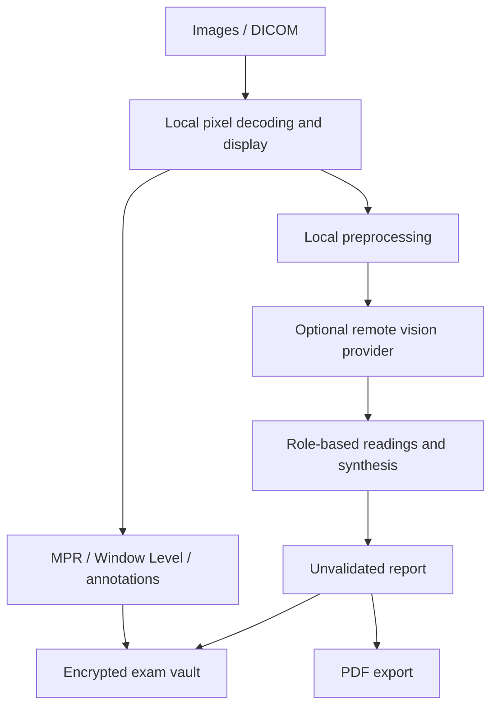

# MedVision AI Pro 17.1.5 — Studio Niko Design

**Browser-based medical image visualization, local DICOM/MPR and optional remote multimodal AI — research prototype.**

Un laboratoire d'imagerie séparant le traitement des pixels, la reconstruction multiplanaire, le stockage local et les interprétations génératives distantes. L'objectif est de faciliter l'exploration technique, non de fournir un diagnostic ou un outil de décision clinique.

[](imaging-pro.js) [](index.html) [](package.json)  [](LICENSE)

**STUDIO NIKO DESIGN** · Build smart. Stay lightweight. Create without limits.

[English overview](#english-overview) · [Quickstart](#quickstart--démarrage-rapide) · [Portfolio](https://github.com/Nikoju1977)

> [Insérer ici un GIF de démonstration avec données synthétiques / Insert synthetic-data demo GIF here]

> **Prototype non validé cliniquement.** Ne pas utiliser pour un diagnostic, une prescription, un triage, une décision de traitement ou une urgence. En France, danger immédiat : 15 ou 112. Inspection statique uniquement ; aucun nouveau test d'exécution, audit de sécurité, test fournisseur, benchmark, validation clinique ou vérification de déploiement n'a été effectué.

## Fonctionnalités clés

- Décodage DICOM monochrome non compressé, MPR axial/coronal/sagittal, Window/Level, crosshair et cine.
- Visualisation, comparaison, annotations, mesures conditionnées par la calibration et import de séries.
- Prétraitement local, routage des modèles vision, lectures par rôles et synthèse distante ; analyse générale séparée.
- Coffre local pour examens, restauration, export PDF et PWA ; configuration fournisseur conservée séparément.
- Build reproductible prévu par les outils du dépôt et tests automatisés sur données synthétiques et réponses simulées.

## Architecture & algorithmes



| Module inspecté | Méthode / limites |
| --- | --- |
| [imaging-pro.js](imaging-pro.js) | Décodage des éléments DICOM, projection de la position sur la normale dérivée de l'orientation, tri des coupes, regroupement par série et espacement médian. Rescale Slope/Intercept transforme les pixels ; le sens HU dépend de la modalité et des métadonnées. |
| MPR / Window-Level | Extraction des plans du volume discret ; inversion MONOCHROME1. Les espacements manquants peuvent être remplacés par des valeurs de secours : ne pas considérer les distances comme étalonnées sans vérifier les métadonnées. Les syntaxes compressées sont hors périmètre. |
| [index.html](index.html) | Prétraitement, découverte/routage des modèles Mistral ou endpoint compatible OpenAI, lots d'images, triage, rôles et synthèse. Des rôles différents ne garantissent pas une expertise indépendante ni une fiabilité clinique. |
| [tools/build_vercel.py](tools/build_vercel.py) / [sw.js](sw.js) | Construction de l'artefact et cache applicatif. |
| [web-knowledge.js](web-knowledge.js) | Recherche documentaire externe Europe PMC et ClinicalTrials ; les requêtes peuvent quitter le navigateur. |

**Risques cliniques :** les mesures dépendent de la qualité de l'acquisition et des métadonnées. Le volume peut sélectionner la série majoritaire et utiliser des espacements par défaut. La reconstruction ne constitue pas une station radiologique qualifiée ; orientations obliques, séries incomplètes, précision géométrique et valeurs de pixels nécessitent validation indépendante. Un rapport génératif peut omettre une anomalie ou inventer un résultat. Ne pas utiliser pour diagnostic, triage, exclusion de maladie ou traitement.

## Confidentialité et sécurité

- Le coffre d'examens utilise AES-256-GCM, PBKDF2-SHA-256 à 250 000 itérations, sel de 16 octets et IV de 12 octets. Le code numérique de 6 à 12 chiffres et le verrouillage local ne garantissent pas la résistance à une attaque hors ligne ; la limitation d'essais est stockée localement.
- `VAULT.decrypt` accepte aussi les anciens enregistrements en clair. La migration effective de tous les dossiers historiques doit être vérifiée. Les clés API et paramètres d'endpoint sont conservés hors de l'enveloppe chiffrée dans le stockage de configuration ; ne pas les présenter comme protégés par le coffre.
- Les images et le contexte sont transmis au fournisseur choisi lorsqu'une analyse distante est lancée. Les informations inscrites dans les pixels ne sont pas automatiquement anonymisées. MedGemma est une option d'endpoint externe, pas un modèle installé par ce dépôt.
- Les exports PDF et la session déverrouillée peuvent exposer des données ; les ressources CDN et services documentaires nécessitent une revue des flux. Ne pas utiliser de données médicales réelles dans la version de démonstration.
- Le journal local et le chiffrement ne constituent ni un audit immuable, ni une authentification organisationnelle, ni une preuve Part 11.

## Référentiels et limites

DICOM (pour l'imagerie concernée), ISO 13485 (qualité), IEC 62304 (cycle de vie logiciel), ISO 14971 (risques), RGPD (données personnelles) et FDA 21 CFR Part 11 (enregistrements électroniques réglementés) sont des pistes de qualification selon l'usage prévu et le cadre applicable. Aucun certificat, marquage CE, autorisation réglementaire, audit indépendant ou conformité à ces référentiels n'est revendiqué. Les licences logicielles ne constituent pas une autorisation d'usage clinique. Une revue par des professionnels qualifiés est indispensable avant tout usage médical.

## Quickstart / Démarrage rapide

Avec Node.js 22+ et Python 3, lancer les commandes documentées ci-dessous. Utiliser uniquement des DICOM synthétiques ou des images de test non identifiantes, sans clé fournisseur réelle. Ne pas utiliser les rapports pour une décision médicale.

## Documentation technique et historique

Les instructions et tests historiques sont conservés ci-dessous ; les limites de sécurité et d'usage énoncées plus haut prévalent. Les preuves de CI doivent être consultées par révision.

> **Projet signature · 04/06 · VISUALISATION** — [Étude de projet : problème, choix techniques et limites](https://github.com/Nikoju1977/Nikoju1977/blob/main/SHOWCASE.md) · [Portfolio Studio Niko Design](https://github.com/Nikoju1977).


Prototype de visualisation et de lecture d’images assistée par IA. Création : Nicolas Julienne — Studio Niko Design.

**Release applicative déclarée : 17.1.5** — artefact destiné à GitHub Pages et Vercel ; validation de la production non réexécutée ici.

**Application : https://nikoju1977.github.io/medicalvisionproai/**

## Démarrage

1. Au premier accès, choisissez un code de 6 à 12 chiffres et confirmez-le. Conservez ce code : il permet de déchiffrer vos dossiers sur cet appareil.
2. Importez des images JPEG, PNG, WebP ou BMP pour l’analyse médicale ou visuelle standard. Pour une série DICOM, utilisez **DICOM / MPR** : la v17 décode localement les DICOM monochromes non compressés et reconstruit les plans axial, coronal et sagittal.
3. Ouvrez **Configurer l’IA**. Pour Mistral, renseignez votre clé personnelle et choisissez **Auto Éco**. Le bouton **Tester** utilise une image géométrique synthétique ; il ne transmet aucun examen.
4. Enregistrez la configuration puis lancez l’analyse. **Arrêter l’analyse** annule les requêtes en cours et celles en attente.

Aucune clé n’est fournie par ce dépôt. L’accès à l’API, ses quotas et ses tarifs dépendent de votre compte fournisseur. Auto Éco sélectionne un modèle vision accessible ; il ne garantit pas la gratuité. Les modèles sont interrogés via le [catalogue Mistral](https://docs.mistral.ai/api/endpoint/models) et la [Chat Completions API](https://docs.mistral.ai/api/endpoint/chat).

## Fonctions disponibles

- Visualisation, comparaison, zoom, mesures calibrées, annotations et zones d’intérêt.
- **Imaging Pro v17** : DICOM monochrome non compressé 8/16 bits, séries CT/MR, reconstruction MPR axial/coronal/sagittal, crosshair synchronisé, Window/Level, presets CT, cine axial et lecture HU lorsque Rescale Slope/Intercept sont présents.
- Import de séries d’images ; extraction de trames vidéo dans les formats décodés par le navigateur (250 Mo maximum).
- Série / évolution pour un même examen ; lot pour des examens indépendants. Les deux boutons d’analyse respectent ce choix.
- Mistral vision ou endpoint privé compatible OpenAI, par exemple un serveur hébergeant MedGemma. MedGemma n’est pas installé ni hébergé par cette application.
- **Image standard / photo** : analyse visuelle non médicale dédiée (description, objets, texte visible, composition/cadrage, couleurs/lumière, qualité et limites), séparée du pipeline médical.
- Sauvegarde locale chiffrée de toute la série, des annotations, du contexte et du rapport ; restauration du dernier examen du patient sélectionné.
- Export PDF d’un rapport médical terminé (bibliothèque jsPDF requise), installation PWA et notification de mise à jour.

## Données et limites

Les images sont traitées localement pour l’affichage. **Lancer l’analyse transmet les images et le contexte clinique au fournisseur configuré.** Retirez les informations identifiantes, y compris celles inscrites dans les pixels. Le prétraitement n’anonymise pas les images.

Les dossiers sauvegardés dans IndexedDB sont chiffrés en AES-256-GCM avec une clé dérivée du code. Les anciennes sauvegardes restent lisibles, y compris certains enregistrements historiques en clair ; leur migration doit être vérifiée. Les clés API sont conservées localement hors du coffre chiffré par la version actuelle ; utilisez cet espace uniquement sur un appareil de confiance. Une sauvegarde navigateur n’est pas une sauvegarde externe : effacer les données du site peut supprimer les dossiers et le code de déchiffrement.

Le cache hors ligne contient uniquement les fichiers applicatifs autorisés, dont le module Imaging Pro. Il ne stocke ni réponses IA ni endpoints patients. L’IA distante requiert une connexion. Le PDF hors ligne dépend du chargement préalable de jsPDF.

**Prototype non certifié comme dispositif médical.** Les tests logiciels ne valident pas les performances diagnostiques. Les réponses IA peuvent être inexactes et ne permettent pas, seules, de poser ou d’écarter un diagnostic.

## Développement, build et tests

Node.js 22 ou supérieur et Python 3 :

```bash
npm ci --ignore-scripts --no-audit --no-fund
npm test
npm run build
npm run validate:dist
python3 -m http.server 8080 --directory dist --bind 127.0.0.1
```

`npm run build` génère `dist/` sans modifier le `index.html` source. Les modules médicaux injectés restent indépendants du numéro de version : la release est pilotée par `package.json`, puis contrôlée automatiquement dans `index.html`, `manifest.json`, `sw.js` et `package-lock.json`. L’artefact publié contient uniquement les ressources nécessaires à l’exécution, sans les outils, tests ou workflows de développement.

Ouvrez ensuite http://localhost:8080 (évitez `file://`, incompatible avec certaines fonctions sécurisées).

Les tests exécutent le JavaScript réel, Canvas, le décodage d’images et WebCrypto dans un hôte Node avec DOM de test. La CI reconstruit également l’artefact de production, valide sa cohérence PWA et vérifie que le build est reproductible et non destructif. Ils couvrent les cinq scénarios d’intégration d’origine et les régressions de configuration, import, sauvegarde, annulation, indices d’images et cache. Un test DICOM synthétique contrôle aussi le décodage CT 16 bits vers HU, l’ordre des coupes et l’espacement 3D. Ils utilisent des réponses IA simulées, sans appel payant. Ils ne remplacent pas un essai dans les navigateurs cibles ni une validation avec un compte IA réel.

Limite Imaging Pro v17 : les Transfer Syntax compressées JPEG/JPEG-LS/JPEG2000, RLE et Deflated ne sont pas encore décodées localement ; l’application les refuse explicitement au lieu de produire une image erronée.

Le banc expérimental `test/bench.js` est séparé ; ses dépendances historiques et son mode d’emploi sont décrits dans `test/BENCH.md`. Il transmet les images du jeu d’essai au fournisseur : ne l’exécuter que sur des données autorisées.

## Roadmap & contribution

Propositions non terminées :

- [ ] Valider le décodage, les orientations, espacements, valeurs HU et mesures sur fantômes numériques et jeux de référence indépendants.
- [ ] Auditer la migration des anciens dossiers, le coffre, la séparation des clés et les flux d'images ; mettre en place une protection adaptée des secrets.
- [ ] Qualifier le rendu, les limites d'analyse, la provenance des résultats et les erreurs sur données synthétiques.
- [ ] Vérifier les builds, tests navigateur et disponibilité des fournisseurs sur la révision courante avant toute revendication de fonctionnement.

**Première contribution / `good first issue` (label proposé, non créé ici) :** Ajouter un cas DICOM synthétique avec espacement manquant ou orientation non standard et résultat attendu explicite.

Les contributions sous MIT sont bienvenues. [Issues](https://github.com/Nikoju1977/medicalvisionproai/issues) pour les anomalies non sensibles. Ne jamais publier de données médicales, images identifiantes, secrets ou détails exploitables de vulnérabilité ; contacter le mainteneur en privé pour les signalements sensibles.

## English overview

MedVision AI Pro 17.1.5 contains a real local DICOM decoder for uncompressed monochrome images, multiplanar display and optional remote vision-model routing. It is not a validated radiology workstation. Geometry and pixel-value fallbacks require independent validation. Exam records are encrypted with AES-GCM/PBKDF2; legacy cleartext records and provider configuration remain separate risks. Remote analysis sends images and context to the selected provider; MedGemma is not hosted by this app. Use synthetic data only.

No new runtime, provider, security or clinical validation was performed for this documentation revision.

## Licence & auteur / License & author

[MIT](LICENSE) © 2026 Nicolas Julienne — Studio Niko Design. Contributions sous MIT pour le code couvert ; les dépendances et composants tiers conservent leurs licences et crédits. Aucun fichier de licence n'a été modifié.

[Studio Niko Design](https://github.com/Nikoju1977)
